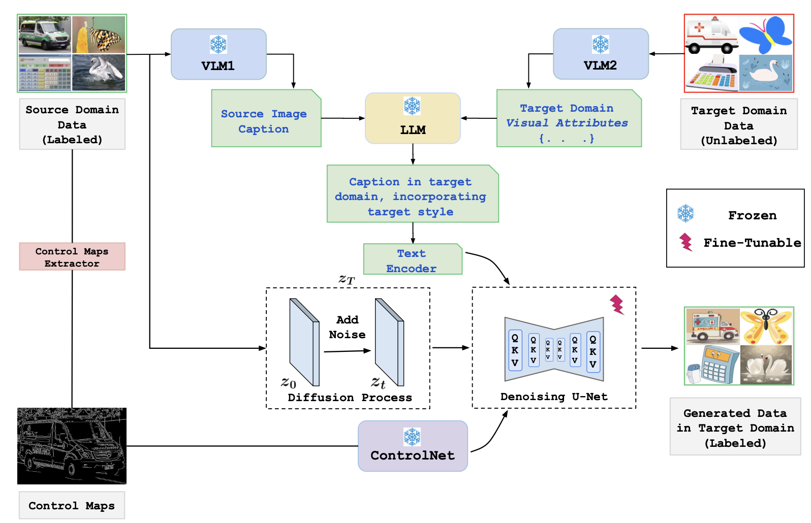

This repository contains the PyTorch implementation of the paper "**An Annotation-Free Framework for Model Ranking in Unlabeled Target Environments via Generative Surrogates**" (*link coming soon*), **R.Subedi**, B.Bashyal, A.Subedi, S.Chakraborty. WACV, 2027.

<p align="center"></p>

## Overview

Given models trained on a labeled source domain, we rank them on an unlabeled target domain by synthesizing labeled surrogate images in the target domain. The generation pipeline has three steps:

1. **Tag generation**: a VLM (Moondream2) extracts a dictionary of visual attributes from a few unlabeled target images.
2. **Diffusion finetuning**: Stable Diffusion XL is LoRA-finetuned on the same unlabeled target images.
3. **Source-to-target conversion**: each source image is captioned, the caption is rewritten by an LLM (Llama-3.1-8B-Instruct) using sampled target attributes, and the finetuned diffusion model with ControlNet generates the target-domain image. Each generated image inherits the label of its source image.

## Repository structure

```
vmr_wacv/
├── config/
│   └── config_painting_to_sketch.json   # all settings and paths
├── script/
│   ├── generate_tags.py                 # step 1
│   ├── finetune_diffusion.py            # step 2
│   └── source_to_target.py              # step 3
└── pipeline.png
```

## Setup

```
pip install torch torchvision transformers diffusers peft accelerate opencv-python pillow tqdm
```

`meta-llama/Llama-3.1-8B-Instruct` is a gated model: request access on Hugging Face and log in with `huggingface-cli login` before running step 3.

## Configuration

All settings are read from a JSON file in `config/`. The provided example, `config/config_painting_to_sketch.json`, covers the Painting → Sketch setting on DomainNet. Before running, fill in the empty entries under `paths`:

| Path | Description |
|---|---|
| `source_dir` | Labeled source images, one subfolder per class |
| `target_dir` | Unlabeled target images |
| `tags_path` | JSON file where the target attribute dictionary is saved |
| `finetuned_model_save_dir` | Folder where the finetuned diffusion model is saved (step 2) |
| `finetuned_model_load_path` | Saved finetuned model to load during generation (step 3); usually the same folder as `finetuned_model_save_dir` |
| `output_dir` | Folder where the generated target-domain images are saved |

`target_subset.fraction` sets the fraction of unlabeled target images used for tag generation and finetuning (`0.01` = 1%, the setting used for DomainNet). For another source-target pair, copy the config file, update the paths and the domain description, and pass it with `--config`.

## Generating labeled images in the target domain

Run the three steps in order from the repository root:

```
python script/generate_tags.py
python script/finetune_diffusion.py
python script/source_to_target.py
```

Each script reads `config/config_painting_to_sketch.json` by default. To use a different file:

```
python script/source_to_target.py --config config/your_config.json
```

The generated images are written to `output_dir/<class_name>/`, using the same class folders as the source data, so the output can be loaded directly as a labeled dataset. The prompts used for each image are saved in `output_dir/prompts.json`.

## Evaluation

To rank the source models on the generated data and compute the transferability scores (H-Score, LEEP, LogME, NCE, PACTran, LFC), please refer to the [Model-Spider](https://github.com/zhangyikaii/Model-Spider) repository. Use the generated images in `output_dir` as the labeled target dataset.

## Citation

If you find this work useful, please cite our paper:

```bibtex
@inproceedings{subedi2027annotation,
  title     = {An Annotation-Free Framework for Model Ranking in Unlabeled Target Environments via Generative Surrogates},
  author    = {Subedi, Ronast and Bashyal, Bishal and Subedi, Aliza and Chakraborty, Shayok},
  booktitle = {IEEE/CVF Winter Conference on Applications of Computer Vision (WACV)},
  year      = {2027}
}
```